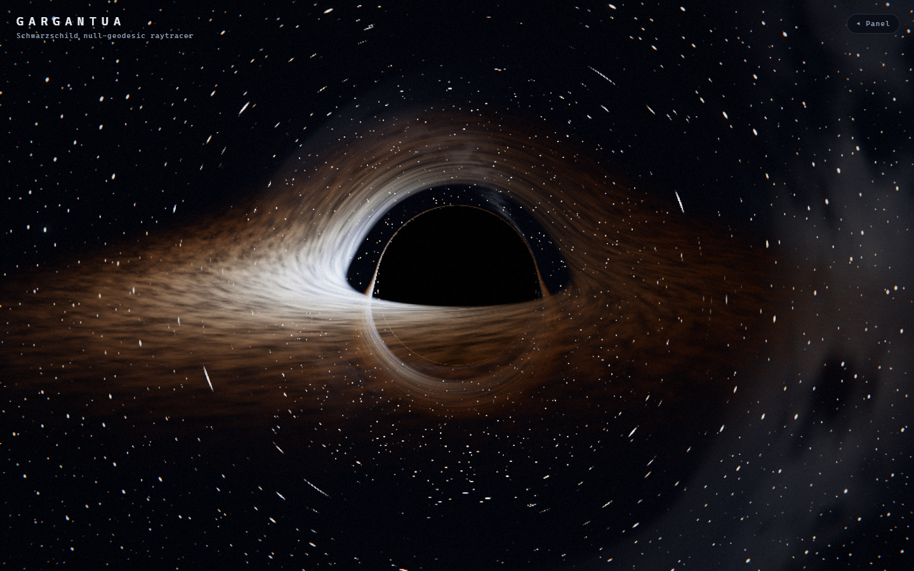
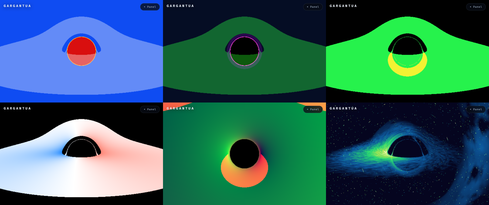

# GARGANTUA — Schwarzschild Black Hole Raytracer

A full-screen interactive black hole. Every pixel of the main image is one
ray that is numerically integrated through Schwarzschild spacetime until it
either leaves for the stars, falls through the event horizon, or runs out of
step budget. The accretion disc is not a ring: it is a sheet of gas that the
bent trajectory cuts, again and again, and the halo over the shadow, the ring
hugging it and the higher-order images underneath are all the same disc seen
through curved light.

Nothing in the picture is a mesh, a texture, a video or a lookup table. The
only geometry in the scene is a full-screen triangle.



## Commands

```bash
npm install          # install the locked dependencies
npm run dev          # development server on http://127.0.0.1:5183/
npm run typecheck    # tsc --noEmit
npm run build        # production build into dist/
npm run preview      # serve the production build on http://127.0.0.1:4183/
```

The production build is a static folder. Any static server will do:

```bash
npx serve dist       # or: python -m http.server -d dist 8080
```

The build is configured with `base: "./"`, so `dist/` can be served from a
subdirectory as well as from a domain root. Nothing is fetched from the
network at runtime: Three.js is vendored under `vendor/`, and the sky, the
stars and the galaxy are all generated in the shader.

## How the picture is made

### The geodesic

The units are Schwarzschild radii. The event horizon is at `r = 1`, so the
geometric mass is `M = 1/2`; the photon sphere is at `r = 3M = 1.5` and the
innermost stable circular orbit at `r = 6M = 3`, which is where the disc's
inner edge sits by default.

A null geodesic in the plane it travels in is described by two conserved
quantities, the energy `E` and the angular momentum `L`:

```
(dr/dλ)² = E² − V_eff(r),      V_eff(r) = L² (r − 2M) / r³
dφ/dλ    = L / r²
d²r/dλ²  = L² (r − 3M) / r⁴
```

The last line is the radial equation; its equilibrium at `r = 3M` is the
photon sphere. The integration is velocity Verlet with a step that scales
with the radius, so the same budget resolves the orbit near the photon sphere
and the long escape to the sky.

**Capture is decided analytically, not by a radius test.** The effective
potential peaks at `V_eff(3M) = L² / (27 M²)`, so a ray coming from outside
reaches the hole exactly when

```
E² > L² / (27 M²)   ⟺   b = |L| / E < 3√3 M
```

`E` and `L` are constants of motion, so `b` is computed once from the initial
conditions and the capture decision is exact however the integration drifts.
That is what keeps the shadow edge a clean curve instead of a band of noise,
and it puts the shadow's angular radius at `b_c = 3√3 M ≈ 2.598 rₛ`, which is
the number the rendered picture is measured against. Debug view `2` draws
that boundary.

### The disc

The disc is a sheet of gas in the plane `z = 0`. The ray finds it where the
bent path crosses that plane. Each crossing contributes emission and optical
depth, and the contributions are composited in the order the ray meets them —
front to back along the path. A ray that winds around the hole accumulates
the primary image, the secondary image over the shadow and the tertiary image
underneath it simply because it passes through the sheet that many times.
Debug view `3` counts the crossings per pixel.

At every crossing the gas is a blackbody with a thin-disc temperature
profile `T ∝ r^(−3/4)`, and the light is modulated by the combined
gravitational and Doppler factor

```
g = √(1 − 2M/r) · 1 / (γ (1 − β·n̂))
```

with `β = √(M/(r − 2M))` the Keplerian speed of the gas and `n̂` the direction
of the photon towards the observer. The colour is shifted by `g` and the
brightness by `g⁴`, which is why the approaching side of the disc is white
and the receding side is deep orange. The gas pattern is a procedural noise
field looked up in a frame that rotates with the local Keplerian rate; because
that rate differs from radius to radius, the pattern is sheared into spiral
filaments the way real gas is.

### The sky

The stars sit on a cube grid around the observer and the galactic band is
unresolved light across one plane of the sky, broken up by noise and cut by
dust lanes. Both are sampled with the direction the *bent* ray ends up
pointing at, so they are lensed with everything else: near the shadow they
smear into arcs and pile up into the photon ring.

### The lens

The geodesic pass writes linear radiance into a half-float target. From there
the frame is bloomed (a mip pyramid with a bright pass, a downsample chain
and an additive tent upsample), exposed, tone mapped with the ACES film
curve, and given a little chromatic dispersion, a little vignette and a
little grain. Bloom is added in linear light before the tone curve;
dispersion is sampled out of the HDR buffer so it bends the bright structures
rather than the display values; the grain is laid on last, in display space,
where film puts it. The debug views bypass all of it — a diagnostic that has
been tone mapped and vignetted is no longer a diagnostic.

## Controls

| Key | Action |
| --- | --- |
| `0` – `9` | debug view |
| `Shift+1` – `Shift+4` | camera presets |
| `Space` | play / pause the cinematic camera loop |
| `H` | show / hide the panel |
| `R` | reset everything to the defaults |
| `Q` | cycle the quality tier |

The camera is an ordinary Three.js `OrbitControls` camera. Drag to orbit,
scroll or pinch to zoom, and the camera's world matrix is read straight into
the shader's ray basis, so what the user moves is exactly what the
integration sees. Touching the canvas hands the camera to the user and stops
the cinematic loop; `Space` or the loop button gives it back.

## The parameter panel

Twenty-four controls, all of them live, all of them resettable on their own
and all of them persisted to `localStorage` under a versioned record
(`gargantua.settings`, version `1`). The panel groups them the way the
picture is built: observer, gas, sky, lens, time. "Reset all" and the `R` key
put everything back.

| Group | Controls |
| --- | --- |
| Camera | field of view, camera distance, camera azimuth, camera elevation |
| Accretion disc | inner radius, outer radius, half-thickness, temperature, emission, opacity, orbital speed, turbulence amplitude, turbulence speed, turbulence scale |
| Background sky | star density, star brightness, galaxy brightness |
| Post-processing | bloom intensity, bloom threshold, exposure, vignette, film grain, chromatic dispersion |
| Simulation | time scale |

## The debug views

| # | View | What it shows |
| --- | --- | --- |
| 0 | Final composite | the finished frame |
| 1 | Ray termination | escaped / captured / out of steps |
| 2 | Horizon & capture boundary | the event horizon mask and the critical curve `b = 3√3 M` |
| 3 | Disc crossing order | how many times the bent ray cut the disc, in path order |
| 4 | First crossing radius | where the ray first met the gas |
| 5 | Gravitational redshift | `√(1 − 2M/r)` at that crossing |
| 6 | Doppler factor | beaming at that crossing; blue approaches, red recedes |
| 7 | Lensed sky coordinates | the direction the escaped ray points at infinity |
| 8 | Stars & galaxy only | the sky on its own, lensed by the same geodesics |
| 9 | HDR before tone mapping | the linear radiance as a log false colour |



## Quality tiers

The three tiers move the three numbers that decide what the frame costs.

| Tier | Internal scale | Steps per ray | Bloom levels | Noise octaves | DPR cap |
| --- | --- | --- | --- | --- | --- |
| Standard | 50 % | 220 | 3 | 3 | 1.0 |
| High | 72 % | 380 | 4 | 4 | 1.5 |
| Cinematic | 100 % | 600 | 5 | 5 | 2.0 |

The integration step also tightens with the tier (0.028 → 0.022 → 0.016 of
the local radius). If the frame stays over budget the internal scale comes
down on its own; it never rises above the tier's own number, and it is
switched off during a capture so a screenshot never depends on how fast the
machine happened to be.

## The URL capture contract

```
?capture=1&quality=high&preset=0&debug=0&time=12.5&hud=0
```

`capture=1` freezes the simulation at `time` and stops the camera loop, so
the frame is reproducible. `quality` accepts `standard`, `high` or
`cinematic`; `preset` accepts `0`–`3`; `debug` accepts `0`–`9`; `hud`
accepts `0` or `1`; `time` accepts any finite non-negative number. Anything
else is dropped and the default is used — a bad link still renders a scene.

Once the shaders have compiled and the first frame has been drawn, the page
sets `document.documentElement.dataset.gargantuaReady = "true"` and exposes

```js
window.__GARGANTUA__ = {
  ready,                  // read-only
  getState(),             // the current settings and the simulation time
  setQuality(level),      // "standard" | "high" | "cinematic"
  setPreset(index),       // 0..3
  setDebug(index),        // 0..9
  setTime(seconds),       // finite and non-negative
};
```

The setters validate their argument and return the updated state, or `null`
if the argument was rejected. They never throw.

## Layout

```
src/
  config/     parameters, presets, debug views, quality tiers, storage, URL state
  scene/      the geodesic shader, the post chain, the renderer
  ui/         the HUD, the parameter panel, one slider
  App.tsx     state, keyboard, the scripting surface
vendor/       Three.js 0.186.1 and the OrbitControls addon, with provenance
evidence/     screenshots taken from the production build
```

`vendor/README.md` records where the vendored Three.js came from and under
what licence.
